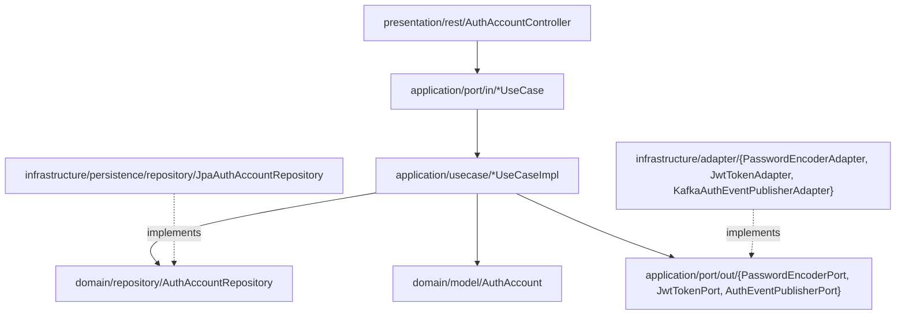

# Fiverr Auth Service (`fiverr-auth-service`)

Authentication, JWT token issuance, and identity management microservice for **Fiverr Club**, built with **Java 21**, **Spring Boot 3.3.5**, **PostgreSQL**, **Redis**, and **Kafka** following strict **Domain-Driven Design (DDD)** and **Hexagonal Architecture (Ports and Adapters)**.

## Hexagonal Architecture Diagram



## REST API Endpoints

| Method | Path | Description |
|--------|------|-------------|
| `POST` | `/api/v1/auth/register` | Register a new Fiverr Club account (`BUYER` / `SELLER`) and issue JWT access + refresh tokens |
| `POST` | `/api/v1/auth/login` | Authenticate with email or username + password and issue JWT tokens |
| `POST` | `/api/v1/auth/refresh` | Exchange a valid refresh token for a new token pair |
| `GET` | `/api/v1/auth/me` | Retrieve current authenticated account (`X-User-Id` header) |
| `GET` | `/api/v1/auth/accounts/{id}` | Retrieve account details by UUID |
| `PUT` | `/api/v1/auth/accounts/{id}/password` | Change account password |

## Kubernetes Readiness & Liveness

- Liveness Probe: `GET /actuator/health/liveness`
- Readiness Probe: `GET /actuator/health/readiness`
- Prometheus Metrics: `GET /actuator/prometheus`

## Build & Test

```bash
JAVA_HOME=/opt/homebrew/opt/openjdk@21 mvn clean test
```
